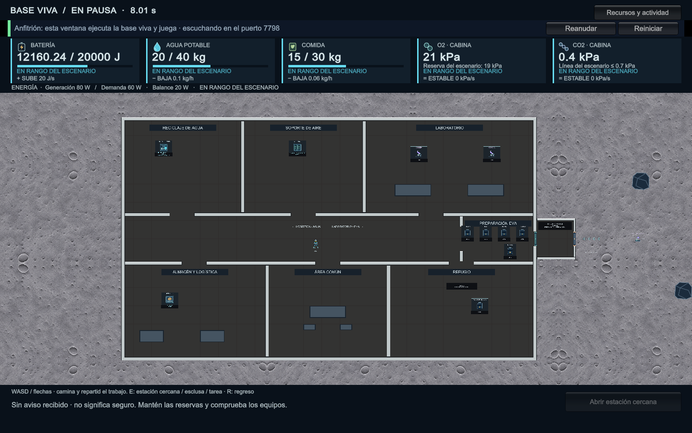
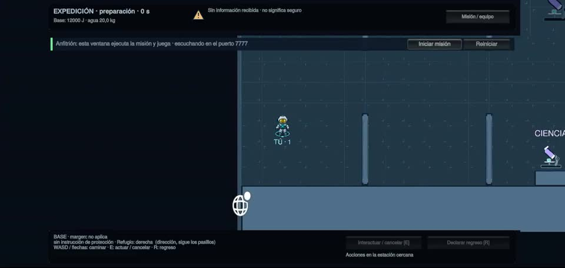

# Space Station Breakdown

**Keep the base running. Protect your reserves. Do science. Bring your team home.**

An educational cooperative **lunar-base management** prototype, built with **Unity Universal 2D** for the **NASA Space Apps Challenge 2026** challenge *Build a Junior Astronaut Mission Trainer*.

The premise is simple: the base keeps operating while the team plays. Sharing maintenance duties, managing supplies, and deciding when to pursue science or return from an expedition matter more than completing a checklist.



*Development screenshot of the lunar-base layout. This overview uses an evidence-capture camera framing, and its palette may differ from the current scene. It does not establish full gameplay validation.*

> **Status:** work-in-progress prototype; phase 4 is being consolidated. This repository includes simulation, presentation, networking, integration, and testing work. It is not a final release or a certified simulator for real space operations.

## Demo

[](https://github.com/SandwichMr/space-station-breakdown/blob/main/docs/demo/gameplay-demo.mp4)

**[Watch the gameplay demo](https://github.com/SandwichMr/space-station-breakdown/blob/main/docs/demo/gameplay-demo.mp4)** — recorded prototype footage. Click the preview to open the video.

## The experience

Players control astronauts in a top-down 2D base, sharing resources, equipment, and decisions. While one player services the water processor, another can check the air system or prepare a scientific expedition. Repairs take time and resources; completing one does not restore resources that have already been lost.

The intended gameplay loop is:

**Observe → prioritize → share the work → intervene → restore operating margin → keep going.**

Scientific tasks and expeditions are activities within the session. Continuous mode is designed so that completing them does not end the session or reset the entire base. Earlier training scenarios retain their finite objectives and outcomes.

## Systems included in the prototype

- **Networked cooperation:** host/client architecture using Unity Transport and WebSocket, with a single simulation authority.
- **Astronauts and navigation:** 2D movement, visible teammates, proximity-based stations, rooms, an airlock, and a lunar exterior.
- **Shared resources:** power and battery reserves, water separated by quality, food, and distinct O2 and CO2 air-service readings.
- **Stations:** water treatment, air-service decisions, science, and logistics, with authority-confirmed state.
- **Maintenance:** synthetic water-processor degradation, diagnosis, isolation, intervention, testing, and restoration to service.
- **Resupply:** ordering, waiting, and unloading under the scenario's rules and limits.
- **EVA:** suit preparation, suit resources, return margin, airlock operations, outdoor science, and return/shelter behavior in the relevant scenarios.
- **Interface:** resource bars, units, trends, occupancy, action results, and unavailable or stale readings.

Implementation details and limitations are documented in the [phase 4 handoffs](docs/phase-04/handoffs/) and the [integration report](docs/phase-04/INTEGRATION.md). A system being present does not mean that every workflow and platform has passed acceptance testing.

## Open the project

### Requirements

- **Unity Hub** and **Unity Editor 6000.3.28f1**, as specified in [ProjectVersion.txt](ProjectSettings/ProjectVersion.txt).
- Git.
- The build-support module for your intended target. Available execution evidence focuses on **Linux**; other targets are not claimed as fully supported without platform-specific testing.

### Setup

```sh
git clone https://github.com/SandwichMr/space-station-breakdown.git
cd space-station-breakdown
```

1. In Unity Hub, add the cloned folder as an existing project.
2. Open it with the specified Editor version and let Unity resolve packages and import assets.
3. Open `Assets/_Project/Scenes/Phase04_LivingBase.unity`.
4. Enter Play Mode. With the playable-authority configuration, the host also controls an astronaut.
5. Click **Iniciar** (Start) in the session controls to move from Ready into active simulation.

Earlier phases remain available in `Assets/_Project/Scenes/` as development and regression scenarios.

### Main controls

- **WASD / arrow keys:** move.
- **E:** interact with a nearby station or panel; at phase 4 stations, this opens the corresponding interface.
- **R:** declare a return during the EVA workflow, when applicable.
- **Interface:** make decisions, inspect resource details, and start, pause, or restart the session.
- **Escape / close panel:** leave the interface as appropriate for its current state.

Actions may be rejected because of distance, occupancy, insufficient resources, or procedure requirements. The interface should display confirmed state, not treat a request as completed merely because it was sent. In-game labels and many linked development notes are currently in Spanish.

## Local multiplayer and development

Build the current project before running multiple processes. Do not launch Unity CLI against a project that is already open in another Editor instance.

Example using the phase 4 tooling's Linux output, from the repository root:

```sh
P="Builds/Phase4LivingBase/StandaloneLinux64/Phase4LivingBase.x86_64"

# Host window: authority and local player.
"$P" -trainer-role authority -trainer-bind 127.0.0.1 -trainer-port 7777

# In another terminal: a client running the same build.
"$P" -trainer-role client -trainer-server 127.0.0.1 -trainer-port 7777 -trainer-connect
```

For a dedicated authority, add `-batchmode -nographics` to the authority process. On a private LAN, choose an appropriate listening address, configure clients with the host's IP address, and allow the connection through the firewall. **Two processes on localhost do not establish LAN, Internet, crossplay, or WebGL/WSS support.**

This README does not configure public hosting or a tunnel. Do not commit credentials or private service addresses.

## Tests, builds, and evidence

The project includes EditMode/PlayMode tests, scenario/composition validators, visual checks, and tools for running an authority and clients. Each type of evidence has a different scope.

Native Test Runner example on Linux, with the project's Editor closed:

```sh
UNITY="/path/to/Unity/Hub/Editor/6000.3.28f1/Editor/Unity"
mkdir -p Logs/local-checks

"$UNITY" -batchmode -nographics -projectPath "$PWD" \
  -runTests -testPlatform EditMode \
  -testResults "$PWD/Logs/local-checks/editmode.xml" \
  -logFile "$PWD/Logs/local-checks/editmode.log"

"$UNITY" -batchmode -nographics -projectPath "$PWD" \
  -runTests -testPlatform PlayMode \
  -testResults "$PWD/Logs/local-checks/playmode.xml" \
  -logFile "$PWD/Logs/local-checks/playmode.log"
```

A headless run does not validate readability, physical keyboard input, or the user experience. Check the XML, exit code, and skipped/inconclusive tests rather than only whether the process finished.

Phase 4 tooling is located in `Assets/_Project/Editor/Build/Phase04/Phase04BuildChecks.cs`. To build the production scene for Linux:

```sh
"$UNITY" -batchmode -nographics -projectPath "$PWD" -buildTarget Linux64 \
  -executeMethod Trainer.Tooling.BuildChecks.Phase04.Phase04BuildChecks.BuildFromCommandLine \
  -logFile "$PWD/Logs/local-checks/build.log"
```

Do not use a forced/diagnostic build as acceptance evidence. Logs and builds are generated locally and are not versioned.

### Validation status

The local XML results from the large-base revision record **551/551 EditMode** and **76/76 PlayMode** tests passing, with no failures or inconclusive cases. **Scene/configuration adjustments were made afterward:** those counts do not, by themselves, certify every subsequent change. Unity was not rerun for that publication because the project was open in the Editor.

Automated continuity checks and executions of earlier builds are documented, including their versions, duration, limitations, and interruptions. **Validation of an earlier build does not automatically apply to a later visual redesign.** Extended acceptance testing with human players remains pending.

References:
- [Integration and fixes](docs/phase-04/INTEGRATION.md).
- [Recorded execution results](docs/phase-04/integration-evidence/RUN_RESULTS_2026-11-15.md).
- [Pending tests and limitations](docs/phase-04/integration-evidence/PENDING_TESTS.md).
- [Human play-session protocol](docs/phase-04/integration-evidence/HUMAN_SESSION.md).
- [Base layout and redesign validation](docs/phase-04/art/LARGE_BASE.md).

## Science and NASA data

The project aims to teach relationships between systems: using energy for science can reduce the margin available to another service; water treatment has inputs, outputs, and losses; returning in time can be the right decision.

Current scenarios use **explicitly identified synthetic parameters** and reduced models. They are not predictions, universal rates, medical thresholds, or a certified reconstruction of a real base.

Integrating **NASA/CCMC DONKI** space-weather records belongs to **phase 5**. It is not presented as an already completed production connection. The plan includes contextualized historical episodes and a clearly labeled synthetic fallback, without requiring a real solar event to occur during a game session.

- A solar flare, a CME, and an energetic-particle event are not equivalent.
- Flare class, Kp, or proton flux cannot be converted directly into a lunar astronaut's dose.
- Missing data does not mean that no hazard exists.
- This version does not require a NASA API key to open the synthetic scenarios. Never include keys in clients, assets, Git, or logs.

Further context: [scientific rules](docs/SCIENTIFIC_RULES.md) and [official DONKI information](https://ccmc.gsfc.nasa.gov/tools/DONKI/).

## Roadmap

- **Phases 1–3:** cooperative power management, interior-base management, and expeditions with return/shelter workflows.
- **Phase 4:** a continuously operated base, resources, maintenance, resupply, and integration; currently being consolidated.
- **Phase 5:** varied setbacks, contextualized NASA data, and renewable activities.
- **Phase 6:** balancing, save/resume support, accessibility, and delivery validation.

Plans are not already available features. Mars is a possible later expansion, not an implemented scenario in this version.

See the current documents in [docs/roadmap](docs/roadmap/), especially [phase 4](docs/roadmap/04_MISSION_OPERATIONS_PROTOTYPE.md), [phase 5](docs/roadmap/05_RELEASE_CANDIDATE.md), and [phase 6](docs/roadmap/06_RELEASE_CANDIDATE.md). The phase 5 filename is historical; its current content covers setbacks and replayability.

## Architecture and collaboration

```text
Unity / presentation / networking
               ↓
          Application
               ↓
           Simulation
```

The authority processes intentions and advances the simulation; clients receive snapshots. Views do not maintain separate inventories or alternative movement controllers.

Project code and assets live in `Assets/_Project/`. Ownership and interfaces are documented in [phase 4 OWNERSHIP](docs/phase-04/OWNERSHIP.md) and the [session contract](docs/phase-04/SESSION_CONTRACT.md). Before contributing, read [AGENTS.md](AGENTS.md), preserve metadata/GUIDs, and do not publish caches or accidentally generated settings changes.

## Credits and licensing

Developed by the project team. [Contributors on GitHub](https://github.com/SandwichMr/space-station-breakdown/graphs/contributors).

Visual-asset provenance and prompts are documented in [phase 4 art](Assets/_Project/Art/Phase04/ART_PROVENANCE.md) and [lunar art](docs/phase-04/art/LUNAR_BASE.md). Using NASA data or references does not imply NASA endorsement or certification of this prototype.

The repository does not yet declare a general license through a LICENSE file. Do not assume an MIT license or any other unpublished permission; consult the authors and each asset's provenance before redistribution.
